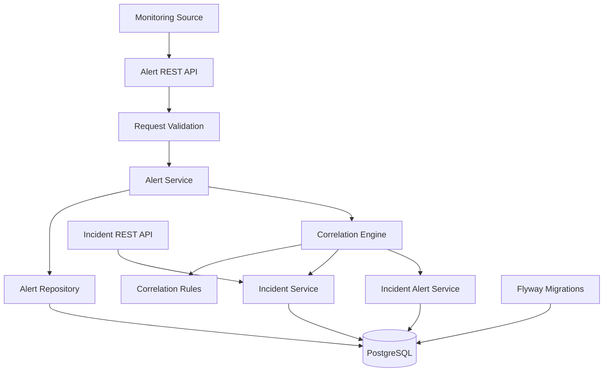

# Alert Fatigue Reducer

A rule-based alert correlation system that groups related monitoring alerts into incidents, helping reduce alert noise and making incident investigation easier.

## Problem

Production monitoring systems can generate multiple alerts from the same operational event. When these alerts are handled independently, responders may face unnecessary alert noise, duplicate investigations, and difficulty identifying related failures.

## Solution

Alert Fatigue Reducer correlates incoming alerts using an explainable, rule-based scoring engine. It evaluates relationships between alerts and existing incidents, then attaches an alert to the best-matching open incident or creates a new incident when no candidate meets the correlation threshold.

The correlation score represents the strength of the rule-based match, **not the probability that an incident's root cause has been identified**.

## Current Features

- **Rule-based alert correlation** using service, environment, alert-type relationships, and time proximity.
- **Weighted correlation scoring** with a configurable decision threshold.
- **Incident creation and alert association** when no existing incident meets the threshold.
- **Incident severity escalation** when a more severe alert is associated with an incident.
- **Incident lifecycle management** with `OPEN` and `RESOLVED` states.
- **Incident filtering** by status and environment.
- **Pagination and sorting** with an allowlist of supported sort fields and a maximum page size.
- **Request validation** for required fields, supported alert types, timestamps, and finite numeric metric values.
- **Consistent API error responses** for validation failures and supported incident exceptions.
- **Database migrations** managed through Flyway.
- **Automated testing**, including unit tests, controller tests, correlation-rule tests, and PostgreSQL integration tests using Testcontainers.

## Technology Stack

| Technology | Purpose |
|---|---|
| Java 17 | Application runtime |
| Spring Boot | REST API and application framework |
| Spring Data JPA | Persistence and database access |
| PostgreSQL | Relational database |
| Flyway | Versioned database migrations |
| Jakarta Bean Validation | Request validation |
| JUnit 5 and Mockito | Automated testing |
| Spring Boot Test / MockMvc | API and application testing |
| Testcontainers | PostgreSQL integration testing |
| Maven | Build and dependency management |

## Architecture

The backend follows a feature-oriented modular monolith structure. Responsibilities are separated into API controllers, application services, persistence components, correlation rules, and shared exception handling.



### Correlation Rules

The engine evaluates several signals:

- **Same service:** alerts originating from the same service.
- **Same environment:** alerts belonging to the same deployment environment.
- **Related alert types:** predefined relationships between alert types.
- **Time proximity:** alerts occurring close together in time.

The individual rule scores are combined and compared against the correlation threshold. Among qualifying candidates, the engine selects the highest-scoring candidate.

The current implementation uses a 10-minute candidate window and a correlation threshold of `0.70`.

## API

Base URL: `http://localhost:8080`

### Create an alert

`POST /api/v1/alerts`

Example request:

```json
{
  "source": "CUSTOM",
  "service": "order-service",
  "environment": "PRODUCTION",
  "type": "CPU_HIGH",
  "severity": "WARNING",
  "message": "CPU usage exceeded threshold",
  "timestamp": "2026-10-08T09:31:00",
  "metric": "cpu_usage",
  "value": 94.5,
  "threshold": 90.0
}
```

The response includes the created alert and its correlation outcome, including the correlation action, incident ID, and correlation score.

Possible correlation actions include `NEW_INCIDENT` and `ATTACHED_TO_INCIDENT`.

### Retrieve an incident

`GET /api/v1/incidents/{incidentId}`

Returns an incident by ID.

### List incidents

`GET /api/v1/incidents`

Optional query parameters:

- `status` — `OPEN` or `RESOLVED`
- `environment` — `DEVELOPMENT`, `STAGING`, or `PRODUCTION`
- `page` — zero-based page index
- `size` — page size, up to 100
- `sort` — an allowed incident field and direction

Example:

```http
GET /api/v1/incidents?status=OPEN&environment=PRODUCTION&page=0&size=20&sort=lastUpdatedAt,desc
```

### Resolve an incident

The incident service supports resolving incidents. A public resolve endpoint is not currently documented because it should only be listed after its controller route is verified.

## Getting Started

### Prerequisites

- JDK 17
- Docker
- Maven Wrapper included in the repository
- PostgreSQL for local application execution

### Database configuration

Configure the PostgreSQL connection in `src/main/resources/application.properties` or provide equivalent external configuration.

The current local configuration uses:

```properties
spring.datasource.url=jdbc:postgresql://localhost:5432/alert_fatigue
spring.datasource.username=postgres
spring.datasource.password=1234
spring.jpa.hibernate.ddl-auto=validate
spring.flyway.enabled=true
```

Replace local credentials with your own configuration before using the application outside a local development environment.

Flyway applies the versioned database migrations when the application starts.

### Run the application

On Windows:

```powershell
.\mvnw.cmd spring-boot:run
```

On Linux or macOS:

```bash
./mvnw spring-boot:run
```

The API runs on port `8080` by default.

### Run tests

On Windows:

```powershell
.\mvnw.cmd test
```

Run the full Maven verification lifecycle:

```powershell
.\mvnw.cmd clean verify
```

PostgreSQL integration tests use Testcontainers and require a working Docker environment.

## Current Limitations

- Correlation is rule-based; there is no machine-learning model or automated root-cause analysis.
- Correlation rules and the decision threshold are predefined in the current implementation.
- Alert ingestion is exposed through a REST API; external monitoring-platform integrations are not yet documented as implemented.
- An Angular frontend and a complete deployment workflow are not described as completed features.
- Authentication, authorization, notification delivery, and automatic remediation are outside the current documented MVP scope.

## Project Status

The backend MVP is under development, with alert correlation, incident management, API validation, database migrations, and automated tests implemented.

The next priority is final regression testing, API documentation, and release-readiness verification.
