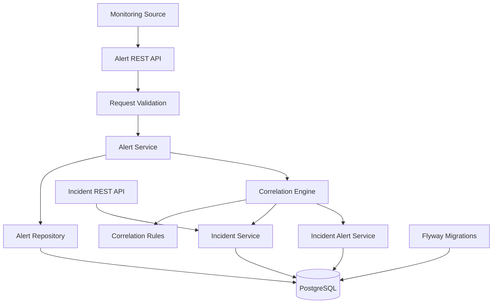

# Alert Fatigue Reducer

A rule-based alert correlation system that groups related monitoring alerts into incidents, reducing alert noise and making incident investigation easier.

## Problem

Production monitoring systems can generate multiple alerts from the same operational event. When these alerts are handled independently, responders face unnecessary alert noise, duplicate investigations, and difficulty identifying related failures.

## Solution

Alert Fatigue Reducer correlates incoming alerts using an explainable, rule-based scoring engine. It evaluates incoming alerts against existing open incidents and either attaches the alert to the highest-scoring qualifying incident or creates a new incident when no candidate meets the correlation threshold.

The correlation score represents the strength of a rule-based match, **not the probability that an incident's root cause has been identified**.

## Features

- **Rule-based alert correlation** using service, environment, alert-type relationships, and time proximity.
- **Weighted correlation scoring** with a decision threshold.
- **Incident creation and alert association** when no existing incident meets the threshold.
- **Incident severity escalation** when a more severe alert is associated with an incident.
- **Incident lifecycle management** with `OPEN` and `RESOLVED` states.
- **Incident filtering** by status and environment.
- **Pagination and sorting** with supported sort-field validation and a maximum page size of 100.
- **Request validation** for required fields, supported alert types, timestamps, and finite numeric metric values.
- **Consistent API error responses** for validation failures and supported incident exceptions.
- **HTTP Basic authentication** for API endpoints, with public health and info endpoints.
- **Database migrations** managed through Flyway.
- **API documentation** through Swagger UI and OpenAPI.
- **Application monitoring** through Spring Boot Actuator.
- **Automated tests**, including unit tests, controller tests, correlation-rule tests, and PostgreSQL integration tests using Testcontainers.

## Technology Stack

| Technology | Purpose |
|---|---|
| Java 17 | Application runtime |
| Spring Boot | REST API and application framework |
| Spring Web MVC | HTTP endpoints |
| Spring Data JPA | Persistence and database access |
| Spring Security | HTTP Basic authentication |
| PostgreSQL | Relational database |
| Flyway | Versioned database migrations |
| Jakarta Bean Validation | Request validation |
| Spring Boot Actuator | Health and application information endpoints |
| Springdoc OpenAPI | API documentation |
| JUnit 5 and Mockito | Automated testing |
| MockMvc | Controller and API testing |
| Testcontainers | PostgreSQL integration testing |
| Maven | Build and dependency management |

## Architecture

The backend follows a **feature-oriented modular monolith** architecture. Application responsibilities are separated into REST controllers, application services, repositories, correlation rules, and shared configuration and exception handling.



### Alert Correlation

The correlation engine evaluates these signals:

- **Same service:** Whether alerts originate from the same service.
- **Same environment:** Whether alerts belong to the same deployment environment.
- **Related alert types:** Whether the alert types have a predefined relationship.
- **Time proximity:** Whether alerts occur within the candidate time window.

The individual rule scores are combined and compared with the correlation threshold. Among qualifying candidates, the engine selects the highest-scoring incident.

Current correlation settings:

| Setting | Value |
|---|---|
| Candidate time window | 10 minutes |
| Correlation threshold | `0.70` |

The scoring mechanism is deterministic and rule-based. It does not perform machine-learning-based root-cause analysis.

## API Reference

Base URL: `http://localhost:8080`

API requests require HTTP Basic authentication. Configure the application credentials before making authenticated requests.

### Create an Alert

`POST /api/v1/alerts`

Example request:

```json
{
  "source": "CUSTOM",
  "service": "order-service",
  "environment": "PRODUCTION",
  "type": "CPU_HIGH",
  "severity": "WARNING",
  "message": "CPU usage exceeded threshold",
  "timestamp": "2026-10-08T09:31:00",
  "metric": "cpu_usage",
  "value": 94.5,
  "threshold": 90.0
}
```

The response includes the created alert and its correlation outcome, including the correlation action, incident ID, and correlation score.

Possible correlation actions include:

- `NEW_INCIDENT`
- `ATTACHED_TO_INCIDENT`

### Retrieve an Incident

`GET /api/v1/incidents/{incidentId}`

Retrieves an incident by its ID.

### List Incidents

`GET /api/v1/incidents`

Supported query parameters:

| Parameter | Description |
|---|---|
| `status` | Filter by `OPEN` or `RESOLVED` |
| `environment` | Filter by `DEVELOPMENT`, `STAGING`, or `PRODUCTION` |
| `page` | Zero-based page index |
| `size` | Page size, up to 100 |
| `sort` | An allowed incident field and sort direction |

Example:

```http
GET /api/v1/incidents?status=OPEN&environment=PRODUCTION&page=0&size=20&sort=lastUpdatedAt,desc
```

### API Documentation

When the application is running:

- Swagger UI: `http://localhost:8080/swagger-ui/index.html`
- OpenAPI specification: `http://localhost:8080/v3/api-docs`

These endpoints are protected by authentication under the current security configuration.

### Health and Application Information

- Health: `GET /actuator/health`
- Application information: `GET /actuator/info`

These endpoints are publicly accessible under the current security configuration. The health endpoint is configured not to expose component details.

## Getting Started

### Prerequisites

- JDK 17
- PostgreSQL
- Docker, for Testcontainers integration tests
- Git
- Maven Wrapper included in the repository

### 1. Clone the Repository

```bash
git clone <repository-url>
cd alert-fatigue-reducer
```

Replace `<repository-url>` with the repository's Git URL.

### 2. Configure the Database

Create a PostgreSQL database named `alert_fatigue`, or configure the application to use an existing database.

Configure the datasource URL, username, and password through `src/main/resources/application.properties` or equivalent external configuration.

Example local datasource configuration:

```properties
spring.datasource.url=jdbc:postgresql://localhost:5432/alert_fatigue
spring.datasource.username=${DB_USERNAME}
spring.datasource.password=${DB_PASSWORD}

spring.jpa.hibernate.ddl-auto=validate
spring.flyway.enabled=true
```

Set `DB_USERNAME` and `DB_PASSWORD` in your environment before starting the application.

**Do not commit database credentials or production secrets to source control.**

Flyway applies versioned database migrations during application startup. Hibernate validates the schema rather than automatically creating or updating it.

### 3. Configure Application Security

The application reads its HTTP Basic credentials from environment variables:

```text
APP_SECURITY_USERNAME
APP_SECURITY_PASSWORD
```

Set both variables before starting the application. Use a strong, unique password and keep it out of Git.

The configured password is encoded using BCrypt before it is stored in the in-memory user configuration. The current implementation provides a single in-memory administrative user; it does not implement persistent user management or a multi-user authorization model.

For production deployment, expose authenticated endpoints only over HTTPS.

### 4. Run the Application

On Windows PowerShell:

```powershell
$env:APP_SECURITY_USERNAME = "admin"
$env:APP_SECURITY_PASSWORD = "<strong-local-password>"
$env:DB_USERNAME = "postgres"
$env:DB_PASSWORD = "<your-local-database-password>"

.\mvnw.cmd spring-boot:run
```

Replace the example database credentials with your actual local PostgreSQL credentials. Do not use the example application credentials in production.

On Linux or macOS, set the same environment variables using your shell or deployment configuration, then run:

```bash
./mvnw spring-boot:run
```

The application runs on port `8080` by default.

### 5. Run Tests

On Windows:

```powershell
.\mvnw.cmd test
```

Run the complete Maven verification lifecycle:

```powershell
.\mvnw.cmd clean verify
```

PostgreSQL integration tests use Testcontainers and require a working Docker environment.

The current verified test suite contains **82 tests**, with all tests passing in the last successful `clean verify` run.

## Security Notes

- API endpoints require HTTP Basic authentication, except for the explicitly permitted Actuator health and info endpoints.
- HTTP Basic credentials must be transmitted over HTTPS outside local development.
- The configured user is stored in memory; credentials and users do not persist in the database.
- CSRF protection is disabled for the stateless API security configuration.
- Database and application secrets should be supplied through environment variables or a secret-management mechanism.

## Current Limitations

- Correlation uses predefined, explainable rules rather than machine learning.
- Correlation rules and the decision threshold are predefined in the current implementation.
- Alert ingestion is exposed through a REST API; external monitoring-platform integrations are not documented as implemented.
- Persistent user management, fine-grained authorization, notification delivery, and automatic remediation are outside the current MVP scope.
- A frontend and a complete production deployment workflow are not included in the documented backend scope.

## Project Status

The backend MVP implements alert ingestion, explainable alert correlation, incident management, validation, database migrations, authenticated API access, API documentation, and automated testing.

The latest verified build completed successfully with **82 tests passing**.

The project is intended to demonstrate practical backend engineering concepts, including modular application design, rule-based decision logic, REST API development, persistence, security configuration, and automated integration testing.
